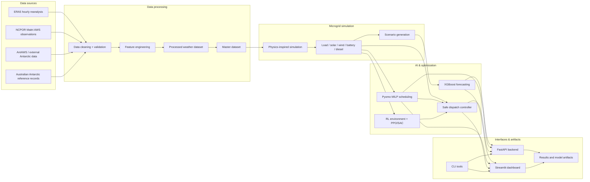

# PolarGrid AI

Physics-informed energy management prototype for an Antarctic research-station microgrid, modeled around Maitri Research Station in Antarctica (70.75°S, 11.75°E). The repository combines weather-data processing, simulated energy assets, XGBoost forecasting, Pyomo optimization, PPO/SAC reinforcement learning, safe-dispatch logic, a FastAPI service, and a Streamlit dashboard.

> Scope and safety: this repository is a research/demo prototype, not an operational station controller. ERA5 is weather reanalysis; NCPOR Maitri AWS is observational weather data for its available period. The station load, renewable generation, battery operation, diesel use, and related energy metrics are simulated. Australian Antarctic electricity/fuel records are reference data from other stations, not Maitri measurements. The implemented safety layer is not a certified protection system and does not guarantee uninterrupted or critical-load power in every possible condition. Do not connect this software to real equipment without validated site data, engineering review, independent protections, and operational procedures.

## Contents

- [Overview](#overview)
- [System architecture](#system-architecture)
- [Data provenance and processing](#data-provenance-and-processing)
- [Core modules](#core-modules)
- [Forecasting and optimization](#forecasting-and-optimization)
- [Reinforcement learning](#reinforcement-learning)
- [Install and run](#install-and-run)
- [Dashboard and API](#dashboard-and-api)
- [Configuration](#configuration)
- [Project structure](#project-structure)
- [Limitations and troubleshooting](#limitations-and-troubleshooting)
- [References and acknowledgements](#references-and-acknowledgements)

## Overview

PolarGrid AI is designed to model a remote Antarctic microgrid with:

- weather and environmental inputs from ERA5 and site observations
- simulated station load, solar PV, wind generation, battery storage, and diesel generation
- forecasting of demand and renewable output using XGBoost regressors
- dispatch scheduling via Pyomo MILP with a heuristic fallback when GLPK is unavailable
- PPO/SAC reinforcement learning for controller experimentation
- safe dispatch logic enforced by a shared feasibility and safety routine
- a FastAPI backend plus a Streamlit dashboard for research workflows

The goal is to provide a reproducible, local-first microgrid research workflow for benchmarking, experimentation, and demonstration without live plant telemetry.

## System architecture



### Detailed execution flow

1. Raw weather and external reference datasets are loaded and cleaned.
2. A processed weather table and master dataset are built with aligned timestamps and engineered features.
3. The simulation engine generates hourly synthetic microgrid behavior for load, renewable generation, battery state, diesel status, and scenario cases.
4. Forecasting models estimate future load and renewable generation.
5. Optimization and RL modules propose or benchmark dispatch actions.
6. A shared safety/dispatch layer validates feasibility, power balance, and asset constraints before returning decisions.
7. The API and dashboard expose the outputs to the user.

## Data provenance and processing

### Inputs

- ERA5: hourly reanalysis at the modeled Maitri coordinates.
- NCPOR Maitri AWS: observational weather data for its available record period.
- Australian Antarctic Division reference data: electricity/fuel records for other Australian Antarctic stations; useful as external reference/calibration material, not Maitri ground truth.
- AntAWS: Antarctic weather records for comparison and cross-validation.

### Processing pipeline

`src.data.run_pipeline_data` performs the core pipeline:

- reads raw weather and external datasets
- validates and cleans records
- handles missing values and sentinel values
- derives temporal and weather features
- builds processed weather tables and a master dataset
- merges baseline energy columns when available

The simulation phase then uses the generated master dataset and configuration files under `configs/` to build synthetic hourly station operations, including renewable generation and system constraints.

See [`docs/data_dictionary.md`](docs/data_dictionary.md) and [`docs/methodology.md`](docs/methodology.md) for current data columns and model assumptions. Where those documents differ from the code, the executable implementation and configuration are authoritative.

## Core modules

### Data processing

- `src/data/`: cleaning, validation, feature generation, and master-dataset assembly
- `configs/`: station, battery, diesel, renewable, and scenario assumptions

### Simulation

- `src/simulation/`: physics-inspired modeling for load, solar, wind, battery, diesel, and scenario behavior

### Forecasting

- `src/forecasting/`: XGBoost training pipelines and evaluation utilities
- `results/forecasts/`: metrics, prediction files, and forecast plots

### Optimization

- `src/optimization/`: Pyomo MILP formulation, objective functions, constraints, and a heuristic fallback
- `results/optimization/`: schedule outputs and optimization artifacts

### Reinforcement learning

- `src/reinforcement_learning/`: Gymnasium environment, PPO/SAC training, and evaluation logic
- `models/rl/`: saved trained controller archives
- `results/comparison/`: benchmark outputs for rule-based vs. RL controllers

### Dispatch and safety

- `src/dispatch/`: rule-based and RL-compatible controller logic
- `src/metrics/`: performance, battery, cost, and reliability metrics
- Shared safety logic ensures dispatch actions respect configured physical and operational limits

### Interfaces

- `api/`: FastAPI service with health, forecast, dispatch, metrics, alerts, and optimization endpoints
- `dashboard/`: six-page Streamlit application for overview, forecasting, dispatch, battery, diesel, and scenarios
- `cli.py`: command-line access for quick status and benchmark checks

## Forecasting and optimization

### Forecasting

The forecasting workflow trains separate XGBoost regressors for:

- station load demand
- solar generation
- wind generation

It uses chronological train/validation/test partitions and writes model artifacts and evaluation outputs to `models/forecasting/` and `results/forecasts/`.

Run evaluation/training with:

```bash
python -m src.forecasting.evaluation
```

This writes `results/forecasts/forecast_metrics.json`, `forecast_predictions.csv`, and plots. The API `/forecast` endpoint reads those saved outputs; it does not perform a fresh inference from a request payload.

### MILP scheduling

The optimization module minimizes operating cost while respecting energy balance, battery limits, diesel constraints, load satisfaction, and renewable availability. The Pyomo model schedules renewable use, battery charge/discharge and SOC, diesel output/on/off/startup, and unmet load over a user-defined horizon.

A GLPK-based MILP solve is preferred when available; if GLPK is missing or a solve fails, the code falls back to a heuristic schedule and marks the result as non-optimal. See `src/optimization/constraints.py`, `src/optimization/objective.py`, and `src/optimization/milp_model.py` for the precise formulation.

## Reinforcement learning

The RL workflow builds a custom Gymnasium environment over the processed dataset and trains PPO and SAC controllers against a simulated microgrid objective. The environment includes:

- state representation based on demand, renewable output, battery SOC, diesel status, temperature, time of day, season, and net deficit
- action space that modulates battery target, diesel target, and on/off request
- safety enforcement through shared dispatch constraints
- reward shaping based on operating cost, throughput degradation, unmet load, and SOC behavior

Training examples:

```bash
# Train both agents and evaluate the available controllers
python scripts/run_rl.py --timesteps 15000

# Train only PPO or SAC
python -c "from src.reinforcement_learning.train_ppo import train_ppo_agent; train_ppo_agent()"
python -c "from src.reinforcement_learning.train_sac import train_sac_agent; train_sac_agent()"
```

The evaluator writes controller logs under `results/rl/` and comparison outputs under `results/comparison/`. The saved model files are research artifacts, not field-certified operational controllers.

## Install and run

### Requirements

- Python 3.11 recommended
- `requirements.txt` provides the project dependencies
- GLPK is optional; without it, optimization uses the heuristic fallback
- JupyterLab is not included in `requirements.txt`; install it separately if needed

### Windows (PowerShell)

```powershell
py -3.11 -m venv .venv
.\.venv\Scripts\Activate.ps1
python -m pip install --upgrade pip
python -m pip install -r requirements.txt
```

### macOS/Linux

```bash
python3.11 -m venv .venv
source .venv/bin/activate
python -m pip install --upgrade pip
python -m pip install -r requirements.txt
```

### Build processed data and simulations

```bash
python -m src.data.run_pipeline_data
python -m src.simulation.run_simulation
```

Run in this order. The simulation requires `data/processed/master_dataset.csv` and updates it with simulated energy values while writing scenario outputs under `data/simulated/`.

### Start the dashboard and API

Start each service in its own terminal from the repository root:

```bash
# Terminal 1
python -m uvicorn api.main:app --host 127.0.0.1 --port 8000

# Terminal 2
python -m streamlit run dashboard/app.py
```

Open:

- Dashboard: http://localhost:8501
- API docs: http://localhost:8000/docs
- Health check: http://localhost:8000/health

### Docker Compose

```bash
docker compose up --build
```

This exposes the dashboard on port 8501 and the API on port 8000, while mounting the project data, models, and results directories.

## Dashboard and API

### Streamlit dashboard

The dashboard exposes six views:

1. Overview
2. AI Forecasting
3. Energy Dispatch
4. Battery Storage
5. Diesel Generator
6. Polar Scenarios

These pages read local datasets and generated artifacts to visualize weather-driven system behavior, dispatch decisions, battery state, generator usage, and simulation scenarios.

### FastAPI backend

The API includes:

| Method | Path | Purpose |
|---|---|---|
| GET | `/health` | Service health and version |
| POST | `/forecast` | Return saved forecast outputs from the prediction CSV |
| POST | `/dispatch` | Compute a single safe-dispatch decision in rule-based or RL mode |
| GET | `/metrics` | Summarize recent microgrid performance |
| GET | `/alerts` | Return data-driven system alerts |
| POST | `/optimize` | Run a MILP or heuristic optimization schedule |

Example requests:

```bash
curl -X POST http://localhost:8000/dispatch \
  -H "Content-Type: application/json" \
  -d '{"load_kw":60,"solar_gen_kw":15,"wind_gen_kw":20,"temperature":-15,"battery_soc":0.65,"controller_mode":"rule_based"}'

curl -X POST http://localhost:8000/forecast \
  -H "Content-Type: application/json" \
  -d '{"hours_ahead":24,"model_type":"xgboost"}'

curl -X POST http://localhost:8000/optimize \
  -H "Content-Type: application/json" \
  -d '{"horizon_hours":24,"solver":"glpk"}'
```

## Configuration

| File | Configures |
|---|---|
| `configs/station_config.yaml` | Modeled station location, load assumptions, and provenance notes |
| `configs/renewable_config.yaml` | Hypothetical solar PV and wind asset parameters |
| `configs/battery_config.yaml` | Battery capacity, SOC bounds, power limits, efficiencies, degradation cost, and derating |
| `configs/diesel_config.yaml` | Diesel capacity, minimum load, fuel curve, costs, and operational assumptions |
| `configs/scenarios.yaml` | Scenario conditions and evaluation labels |

These files define the simulation assumptions. Review and calibrate them before interpreting scenario, cost, or dispatch outputs.

## Project structure

```text
PolarGrid_AI/
├── api/                     # FastAPI app, request schemas, and endpoint routers
├── configs/                 # Station, asset, and scenario configuration
├── dashboard/               # Streamlit app, pages, components, and API helpers
├── data/
│   ├── raw/                 # External weather and reference datasets
│   ├── processed/           # Cleaned tables and master_dataset.csv
│   └── simulated/           # Generated simulation outputs
├── docs/                    # Methodology, data dictionary, and research notes
├── models/
│   ├── forecasting/         # Saved XGBoost model artifacts
│   └── rl/                  # Saved PPO/SAC model archives
├── notebooks/               # Analysis and modeling notebooks
├── results/
│   ├── comparison/          # Controller comparison outputs
│   ├── forecasts/           # Forecast metrics, predictions, and plots
│   ├── optimization/        # MILP and heuristic schedules
│   └── rl/                  # RL run logs and dispatch outputs
├── scripts/                 # Pipeline and training runner scripts
├── src/                     # Core Python modules for data, simulation, forecasting, optimization, dispatch, RL, and metrics
├── tests/                   # Pytest coverage for API, dispatch, forecasting, optimization, RL, and simulation
├── cli.py                   # Local status, forecast, dispatch, and benchmark commands
├── Dockerfile               # Container build for deployment
├── docker-compose.yml       # Multi-service local deployment setup
├── README.md                # Project documentation
├── requirements.txt         # Python dependencies
└── .gitignore               # Repository ignore rules
```

Useful local CLI commands:

```bash
python cli.py --help
python cli.py status
python cli.py forecast --hours 12
python cli.py dispatch --load 65 --solar 20 --wind 30 --soc 0.5 --temp -15 --mode rule_based
python cli.py benchmark
```

## Limitations and troubleshooting

- Missing master dataset: run `python -m src.data.run_pipeline_data` and then `python -m src.simulation.run_simulation`.
- Forecast endpoint reports missing predictions: run `python -m src.forecasting.evaluation`.
- RL model not found: run `python scripts/run_rl.py --timesteps 15000`; otherwise the controller may fall back to rule-based dispatch.
- MILP is not optimal: verify GLPK is installed and available to Pyomo. A returned heuristic schedule is a fallback, not an optimal solution.
- Notebook launch fails: install JupyterLab separately; it is not included in `requirements.txt`.
- Results differ: validate configuration, dependency versions, dataset state, randomization, and whether a native solver or fallback was used.
- No live station integration: there is no sensor ingestion, actuator interface, telemetry transport, authentication, or production monitoring.
- Modeling limitations: demand, renewables, fuel curves, thermal derating, and operating costs are simplified. External Australian energy data is not Maitri ground truth.
- Safety limitations: code-level constraints do not replace independent generator, battery, and microgrid protection systems or engineering safety certification.

## References and acknowledgements

- ERA5 reanalysis: ECMWF / Copernicus Climate Change Service
- Maitri AWS observations: National Centre for Polar and Ocean Research (NCPOR)
- Australian Antarctic reference data: Australian Antarctic Division
- Project context: Smart India Hackathon 2026, Problem Statement 26061
- Main software libraries: XGBoost, Pyomo, Gymnasium, Stable-Baselines3, FastAPI, and Streamlit
