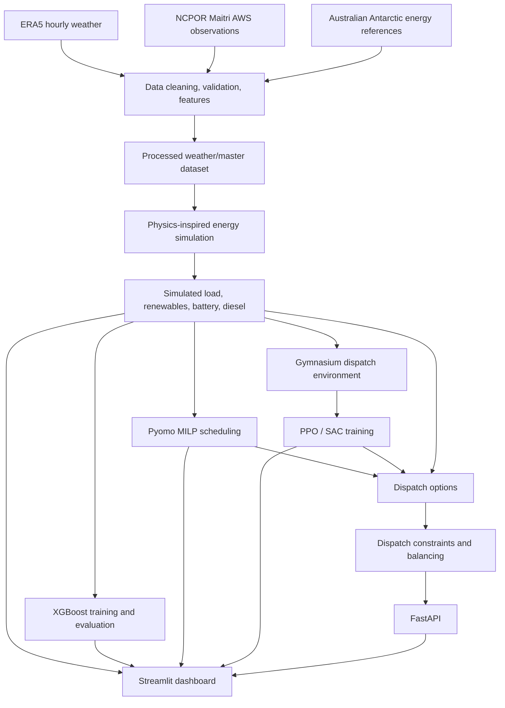

# PolarGrid AI

Physics-informed energy management prototype for an Antarctic research-station microgrid, modeled at the coordinates of Maitri Research Station (70.75°S, 11.75°E). The project combines weather-data processing, simulated energy assets, XGBoost forecasting, Pyomo optimization, PPO/SAC reinforcement learning, safe-dispatch logic, a Streamlit dashboard, and a FastAPI service.

> **Scope and safety:** This repository is a research/demo prototype, not an operational station controller. ERA5 is weather reanalysis; NCPOR Maitri AWS is observational weather data for its available period. The station load, renewable generation, battery operation, diesel use, and related energy metrics are simulated. Australian Antarctic electricity/fuel records are reference data from other stations, not Maitri measurements. The implemented safety layer is not a certified protection system and does not guarantee uninterrupted or critical-load power in every possible condition. Do not connect this software to real equipment without validated site data, engineering review, independent protections, and operational procedures.

## Contents

- [What is implemented](#what-is-implemented)
- [Architecture](#architecture)
- [Data and provenance](#data-and-provenance)
- [Reinforcement learning in detail](#reinforcement-learning-in-detail)
- [Forecasting and optimization](#forecasting-and-optimization)
- [Install and run](#install-and-run)
- [Dashboard](#dashboard)
- [REST API](#rest-api)
- [Train and evaluate models](#train-and-evaluate-models)
- [Notebooks and tests](#notebooks-and-tests)
- [Configuration](#configuration)
- [Outputs and project layout](#outputs-and-project-layout)
- [Limitations and troubleshooting](#limitations-and-troubleshooting)
- [References and acknowledgements](#references-and-acknowledgements)

## What is implemented

| Area | Current repository behavior |
|---|---|
| Weather data | Cleaning, validation, feature engineering, and a master dataset built primarily from hourly ERA5. |
| Energy system | Configurable, physics-inspired solar, wind, station-load, battery, and diesel simulations. |
| Forecasting | XGBoost regression models for simulated load, solar generation, and wind generation; evaluation writes metrics, predictions, plots, and model files. |
| Optimization | Pyomo dispatch scheduling with a GLPK solver when available and a heuristic fallback when it is not. |
| Reinforcement learning | Gymnasium environment and Stable-Baselines3 PPO/SAC training and evaluation scripts. Existing model archives are under `models/rl/`. |
| Dispatch | Rule-based and RL controller paths use the shared dispatch safety/feasibility routine. A precomputed MILP schedule can also be supplied to the controller in code. |
| User interfaces | Six-page Streamlit dashboard, FastAPI endpoints, and a small command-line interface. |
| Validation | Pytest tests cover API endpoints, dispatch, forecasting, MILP, RL environment behavior, and simulation. Passing tests is not operational certification. |

Results depend on the checked-in data, configuration values, installed solver, model artifacts, and the particular run. Treat all headline metrics as experiment outputs, not field-validated performance guarantees. Recompute them for the current environment with the evaluation workflow below.

## Architecture



### Main code areas

- `src/data/`: source loaders, cleaning, validation, feature engineering, and master-dataset generation.
- `src/simulation/`: solar, wind, station load, battery, diesel, and polar scenario simulation.
- `src/forecasting/`: XGBoost model feature construction, training, and evaluation.
- `src/optimization/`: Pyomo model, objective, constraints, and heuristic dispatch fallback.
- `src/reinforcement_learning/`: Gymnasium environment, PPO/SAC training, and controller evaluation.
- `src/dispatch/`: rule-based dispatch, controller integration, and the shared constraint routine.
- `src/metrics/`: fuel, cost, reliability, battery, and renewable-use metrics.
- `api/`: FastAPI application, request/response schemas, and forecast, dispatch, and optimization routes.
- `dashboard/`: Streamlit application, six dashboard views, charts, cards, and data/API helpers.
- `configs/`: station and asset assumptions plus scenario definitions.

## Data and provenance

### Inputs

- **ERA5:** hourly reanalysis at the modeled Maitri coordinates. The loader expects `data/raw/ERA5/ERA5_raw_original.csv`.
- **NCPOR Maitri AWS:** observational weather data; the loader expects `data/raw/NCPOR_Maitri/NCPOR_Maitri_AWS_raw_combined.csv`. The available record is shorter and may contain `-999` sentinels.
- **Australian Antarctic Division reference data:** electricity and fuel records for Australian stations. These are useful as external reference/calibration data only; they are not Maitri energy measurements.
- **AntAWS:** Antarctic AWS records at other stations. The loader has helpers for this data, but the main data-pipeline function does not merge all AntAWS files into the Maitri master dataset.

### Processing and simulation

`src.data.run_pipeline_data` cleans the sources, validates weather ranges and overlapping AWS/ERA5 records, derives temporal/weather features, and writes processed tables. It uses ERA5 as the master weather timeline. If the baseline file exists, its energy columns are merged; the subsequent simulation step writes its simulated energy variables back to the master dataset.

The simulation uses values in `configs/` to generate energy-system data. The current configuration describes a hypothetical installation (including a 500 kWh battery, solar PV, wind turbines, and diesel generation); these values are not asserted to be Maitri plant specifications. Scenario definitions include normal operation, polar night, extreme cold, low renewables, load spikes, and generator failure.

See [`docs/data_dictionary.md`](docs/data_dictionary.md) for the documented columns and [`docs/methodology.md`](docs/methodology.md) for the current modeling outline. Where those documents differ from executable code, the implementation and configuration are authoritative.

## Reinforcement learning in detail

### Environment and episode

`src.reinforcement_learning.environment.PolarGridEnv` implements a Gymnasium continuous-control environment over rows of the processed master dataset:

- **Episode length:** 168 hourly steps by default. Training samples a random starting row when the data is long enough.
- **Observation:** 10 `float32` values, normalized/clipped from load, solar generation, wind generation, battery SOC, diesel status, temperature, hour, season, polar-night flag, and renewable-adjusted net deficit.
- **Action space:** a three-value `Box` in `[-1, 1]`. The environment maps action 0 to a signed battery target using the configured maximum charge power, action 1 to a diesel target from zero to rated capacity, and action 2 to an on/off request (`> 0` means on).
- **Environment state:** battery SOC and diesel running status are initialized at reset and updated as steps advance.
- **Reward:** estimated diesel fuel cost, generator startup and maintenance costs, battery-throughput degradation cost, and unmet-load penalty are compared with a diesel-only reference cost. The reward also includes SOC shaping terms.
- **Safety routine:** actions are passed to `enforce_safety_constraints`, which calculates battery capability limits from configured SOC/power limits and cold derating, constrains diesel output, and calculates dispatch, curtailment, and unmet load based on renewable availability and demand.

The policy action is not a direct actuator command: the constraint routine determines the final power flow, and the environment/controller path can override the proposed dispatch. In particular, do not assume every learned action component has an independent physical effect or that all loads will always be served. The implementation is a prototype for experimentation and should be reviewed before drawing control-safety conclusions.

### Agents and training

- **PPO:** `src/reinforcement_learning/train_ppo.py` trains a Stable-Baselines3 PPO `MlpPolicy` on the first 85% of the master dataset, with random one-week episode starts. The default call uses 30,000 timesteps; the script wrapper and full-pipeline runner pass 15,000 by default.
- **SAC:** `src/reinforcement_learning/train_sac.py` uses the same chronological 85% training portion and one-week episodes. Its function default is 25,000 timesteps; the wrapper and full-pipeline runner pass 15,000.
- Both agents use seed 42 in their model constructors and save archives to `models/rl/ppo_polargrid.zip` and `models/rl/sac_polargrid.zip`.
- Training requires `data/processed/master_dataset.csv` with the weather and energy columns used by the environment. Generate it with the pipeline below if it is missing or stale.

Example commands from the repository root:

```bash
# Train both agents and evaluate available agents against the rule-based baseline
python scripts/run_rl.py --timesteps 15000

# Train just PPO or SAC with the function defaults
python -c "from src.reinforcement_learning.train_ppo import train_ppo_agent; train_ppo_agent()"
python -c "from src.reinforcement_learning.train_sac import train_sac_agent; train_sac_agent()"

# Re-evaluate the available trained agents and write comparison outputs
python -m src.reinforcement_learning.evaluate_rl
```

The evaluator uses the final 15% of the dataset and currently evaluates up to its first 2,000 rows. It always includes rule-based results and includes PPO/SAC results when the corresponding model archive exists. It writes controller logs under `results/rl/` and comparison files under `results/comparison/`. These are offline experiments, not online learning or a live station connection.

The dashboard's `rl_ppo`/`rl_sac` modes and the dispatch API can load saved archives. If an archive is absent, the dispatch controller logs a warning and falls back to rule-based dispatch. Confirm which mode was actually selected before interpreting a result.

## Forecasting and optimization

### Forecasting

The forecasting modules train separate XGBoost regressors for load, solar generation, and wind generation. Features include weather and calendar fields plus target lags (24/48 hours) and rolling statistics. The implemented training code uses chronological train/validation/test partitions (70%/15%/15%) and persists model files under `models/forecasting/`.

Run evaluation/training with:

```bash
python -m src.forecasting.evaluation
```

It writes `results/forecasts/forecast_metrics.json`, `forecast_predictions.csv`, and plots. The API's `/forecast` endpoint reads the saved prediction CSV: it does **not** make a new inference from a supplied live weather forecast. The CSV represents held-out evaluation predictions, so its first rows should not be mistaken for future real-time forecasts. Re-run evaluation when you need fresh artifacts.

### MILP scheduling

The Pyomo model schedules renewable use, battery charge/discharge and SOC, diesel output/on/off/startup, and unmet load over a caller-provided horizon. It minimizes a configured operating-cost objective subject to the model's power balance, component limits, battery, diesel, and load constraints. `solve_milp` tries the requested solver (GLPK by default); if it is unavailable or does not return an optimal solution, it returns the heuristic schedule and marks `solved` as false.

Install GLPK separately for a native installation if an optimal MILP solve is required. The Docker image installs GLPK. The heuristic fallback is functional, but it is not an optimal MILP result. See `src/optimization/constraints.py`, `src/optimization/objective.py`, and `src/optimization/milp_model.py` for the precise formulation.

## Install and run

### Requirements

- Python 3.11 is used by the Dockerfile and is the recommended runtime.
- Install Python dependencies from `requirements.txt`.
- GLPK is optional for the application; without it, optimization uses its heuristic fallback.
- JupyterLab is not listed in `requirements.txt`; install it separately if you want to run notebooks.

### Windows (PowerShell)

Run commands from the repository root:

```powershell
py -3.11 -m venv .venv
.\.venv\Scripts\Activate.ps1
python -m pip install --upgrade pip
python -m pip install -r requirements.txt
```

If PowerShell prevents environment activation, either use an approved local execution-policy setting or run the environment's Python directly as `.\.venv\Scripts\python.exe`.

### macOS/Linux

```bash
python3.11 -m venv .venv
source .venv/bin/activate
python -m pip install --upgrade pip
python -m pip install -r requirements.txt
```

### Build processed data and simulations

The repository includes processed and simulated data files, but you can regenerate them from the checked-in raw inputs:

```bash
python -m src.data.run_pipeline_data
python -m src.simulation.run_simulation
```

Run in this order. The simulation requires `data/processed/master_dataset.csv`; it updates that file with simulated energy values and writes component/scenario CSVs under `data/simulated/`.

To train/evaluate forecasts and generate their saved artifacts:

```bash
python -m src.forecasting.evaluation
```

For the full sequence including optimization, RL training, and evaluation, `python scripts/run_pipeline.py` is available. It is a **best-effort orchestration script**: several stages catch and log errors rather than fail the entire command. Check each phase's output and expected artifacts; for clear failure handling, run the focused commands above separately.

### Start the dashboard and API

Start each service in its own terminal from the repository root:

```bash
# Terminal 1
python -m uvicorn api.main:app --host 127.0.0.1 --port 8000

# Terminal 2
python -m streamlit run dashboard/app.py
```

Open the dashboard at <http://localhost:8501>, API documentation at <http://localhost:8000/docs>, and health check at <http://localhost:8000/health>. The API and dashboard read files from this repository; keep the expected `data/`, `models/`, and `results/` paths available.

### Docker Compose

Docker Desktop (or a compatible Docker Engine with Compose) is required:

```bash
docker compose up --build
```

The compose service exposes the dashboard on port 8501 and API on port 8000, mounts `data/`, `models/`, and `results/`, and checks the API `/health` endpoint. Stop it with `Ctrl+C` in the foreground, or use `docker compose down` in another terminal. If the dashboard is the only service you need, run Streamlit directly instead of starting the combined container.

## Dashboard

The Streamlit app has six views:

1. **Overview:** station/model status, key indicators, and recent energy views.
2. **AI Forecasting:** saved forecast metrics and prediction visualizations.
3. **Energy Dispatch:** dispatch and controller comparisons from available data/results.
4. **Battery Storage:** battery SOC and related battery metrics.
5. **Diesel Generator:** generator, fuel, and emissions-related views.
6. **Polar Scenarios:** available scenario simulation results.

The views are dashboards over local datasets and generated artifacts; they do not represent live Maitri telemetry. Some pages require generated forecast, simulation, or controller-comparison outputs. The sidebar's benchmark control displays a reminder to launch the evaluator from a terminal; it does not itself run model training.

## REST API

The FastAPI application exposes:

| Method | Path | Purpose |
|---|---|---|
| `GET` | `/health` | Service health and version. |
| `POST` | `/forecast` | Return up to 168 rows from the saved forecast-predictions CSV; requires that file. |
| `POST` | `/dispatch` | Compute a single safe-dispatch step in rule-based or available RL mode. |
| `GET` | `/metrics` | Calculate metrics from the most recent 720 rows of the processed master dataset. |
| `GET` | `/alerts` | Return data-driven alerts from recent dataset rows and optional forecast metrics. |
| `POST` | `/optimize` | Schedule up to 168 rows from the end of the master dataset with MILP or heuristic fallback. |

Interactive request/response schemas are available at `/docs`. Example requests:

```bash
curl -X POST http://localhost:8000/dispatch \
  -H "Content-Type: application/json" \
  -d '{"load_kw":60,"solar_gen_kw":15,"wind_gen_kw":20,"temperature":-15,"battery_soc":0.65,"controller_mode":"rule_based"}'

curl -X POST http://localhost:8000/forecast \
  -H "Content-Type: application/json" \
  -d '{"hours_ahead":24,"model_type":"xgboost"}'

curl -X POST http://localhost:8000/optimize \
  -H "Content-Type: application/json" \
  -d '{"horizon_hours":24,"solver":"glpk"}'
```

The forecast endpoint returns stored predictions rather than forecasting from the request body. The optimize endpoint also reads an existing master dataset; it does not accept a custom weather/load series in its request. For local API tests, required data/results files must be present.

## Train and evaluate models

From the repository root with dependencies installed:

```bash
# Evaluate/train all three forecasting regressors and write plots/metrics/predictions
python -m src.forecasting.evaluation

# Train PPO and SAC and evaluate available controllers
python scripts/run_rl.py --timesteps 15000

# Optional: run the orchestrated sequence (see its best-effort behavior above)
python scripts/run_pipeline.py
```

Forecasting evaluation fits models and writes the model archives. RL training overwrites the matching PPO/SAC archive. Controller evaluation writes logs and comparisons. Preserve or back up artifacts you need before retraining.

## Notebooks and tests

There are eight numbered notebooks in `notebooks/` covering exploration, cleaning, simulation, forecasting, optimization, RL training, and model comparison. To use them, install JupyterLab separately and launch:

```bash
python -m pip install jupyterlab
jupyter lab notebooks/
```

Run the test suite from the repository root:

```bash
python -m pytest tests/ -v
```

The tests exercise the current code paths, not real equipment, live weather ingestion, model quality guarantees, or certification. API tests that call forecast, metrics, and optimization endpoints expect their required generated/check-in data artifacts to exist.

## Configuration

| File | Configures |
|---|---|
| `configs/station_config.yaml` | Modeled station location, load assumptions, and data-provenance notes. |
| `configs/renewable_config.yaml` | Hypothetical solar PV and wind asset parameters. |
| `configs/battery_config.yaml` | Battery capacity, SOC bounds, power limits, efficiencies, degradation cost, and cold derating. |
| `configs/diesel_config.yaml` | Diesel capacity, minimum load, fuel curve, costs, and operational assumptions. |
| `configs/scenarios.yaml` | Scenario conditions and evaluation labels. |

These are model assumptions. Review and calibrate them before interpreting scenario or cost results.

## Outputs and project layout

```text
PolarGrid_AI/
├── api/                    # FastAPI app, schemas, and endpoint routers
├── configs/                # Station, asset, and scenario assumptions
├── dashboard/              # Streamlit app, views, components, and data helpers
├── data/
│   ├── raw/                # Weather observations/reanalysis and external references
│   ├── processed/          # Cleaned tables and master dataset
│   └── simulated/          # Generated energy and scenario data
├── docs/                   # Methodology, data dictionary, and research notes
├── models/
│   ├── forecasting/        # Saved XGBoost model artifacts
│   └── rl/                 # Saved Stable-Baselines3 PPO/SAC archives
├── notebooks/              # Eight analysis and modeling notebooks
├── results/
│   ├── comparison/         # Controller comparison CSV/JSON
│   ├── forecasts/          # Forecast metrics, held-out predictions, plots
│   ├── optimization/       # MILP/heuristic schedules
│   └── rl/                 # Per-controller dispatch logs
├── scripts/                # Pipeline, training, and RL runner scripts
├── src/                    # Data, simulation, forecast, dispatch, MILP, RL, metrics
├── tests/                  # Pytest suites
├── cli.py                  # Local status, forecast, dispatch, benchmark commands
├── Dockerfile
├── docker-compose.yml
└── requirements.txt
```

Useful local CLI commands:

```bash
python cli.py --help
python cli.py status
python cli.py forecast --hours 12
python cli.py dispatch --load 65 --solar 20 --wind 30 --soc 0.5 --temp -15 --mode rule_based
python cli.py benchmark
```

The CLI reads existing local data/results. `status` prints the last row of the processed master dataset, not a live sensor reading. `benchmark` displays a saved controller comparison when present, otherwise it triggers controller evaluation.

## Limitations and troubleshooting

- **Missing master dataset:** run `python -m src.data.run_pipeline_data` and then `python -m src.simulation.run_simulation`.
- **Forecast endpoint reports predictions missing:** run `python -m src.forecasting.evaluation`.
- **RL model not found:** run `python scripts/run_rl.py --timesteps 15000`; a requested RL dispatch can otherwise fall back to rule-based mode.
- **MILP is not optimal:** verify GLPK is installed and available to Pyomo. A returned heuristic schedule is a fallback, not an optimal solution.
- **Notebook launch fails:** install JupyterLab separately; it is not included in `requirements.txt`.
- **Results differ:** verify configuration, dependency versions, the input dataset, randomization, and whether a real solver or fallback was used.
- **No live station integration:** no sensor ingestion, telemetry transport, actuator interface, authentication, or deployment-grade monitoring is implemented here.
- **Modeling limitations:** station demand, renewables, fuel curves, thermal derating, and operating costs are simplified. External Australian energy data is not Maitri ground truth. Short RL runs are proof-of-concept training, and simulated/held-out metrics do not establish field performance.
- **Safety limitations:** tests and code-level constraints do not replace independent generator, battery, and microgrid protections or an operational safety case.

## References and acknowledgements

- ERA5 reanalysis: ECMWF/Copernicus Climate Change Service.
- Maitri AWS observations: National Centre for Polar and Ocean Research (NCPOR).
- Australian Antarctic reference data: Australian Antarctic Division.
- Project context: Smart India Hackathon 2026, Problem Statement 26061 (as described by the project).
- Main software libraries: XGBoost, Pyomo, Gymnasium, Stable-Baselines3, FastAPI, and Streamlit.
# PolarGrid-AI-Antarctic-Microgrid-Energy-Management

